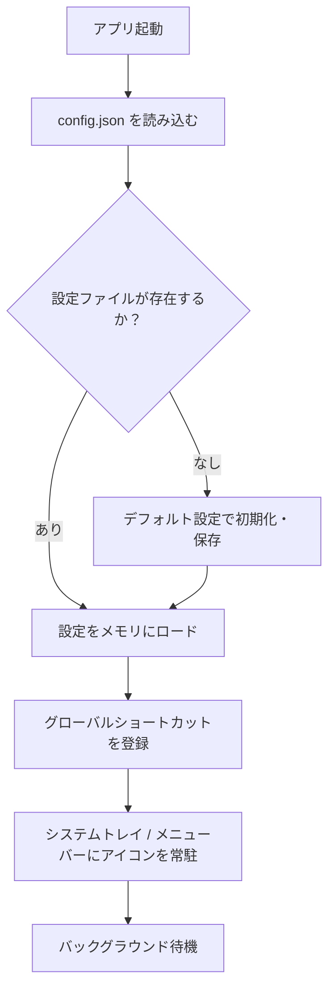

# 技術仕様書

## テクノロジースタック

### 全体構成

```
┌─────────────────────────────────────────────────────┐
│                   Mouse Launcher                     │
│                                                     │
│  フロントエンド          バックエンド                  │
│  HTML / CSS / JS   ←→   Rust（Tauri）               │
│  （UI描画）              （OS操作・ビジネスロジック）   │
└─────────────────────────────────────────────────────┘
```

### 採用技術一覧

| レイヤー | 技術 | バージョン | 採用理由 |
|---|---|---|---|
| アプリケーションフレームワーク | **Tauri v2** | 2.x | 軽量シングルバイナリ、クロスプラットフォーム対応、Rustの安全性 |
| バックエンド言語 | **Rust** | 1.70+ | 高パフォーマンス、OS APIへの直接アクセス、Tauriの標準言語 |
| フロントエンド | **HTML / CSS / JavaScript** | - | シンプルなUIのため追加フレームワーク不要 |
| UIスタイリング | **CSS（Vanilla）** | - | 依存を最小限に保つ |
| 設定ファイル形式 | **JSON** | - | 可読性が高く、Rustでの扱いが容易 |

### Tauriプラグイン

| プラグイン | 用途 |
|---|---|
| `tauri-plugin-global-shortcut` | グローバルショートカットキーの登録・監視 |
| `tauri-plugin-fs` | 設定ファイルの読み書き |
| `tauri-plugin-shell` | アプリケーションの起動 |
| `tauri-plugin-dialog` | ファイル選択ダイアログの表示 |

---

## 開発ツールと手法

### 開発環境

| ツール | 用途 |
|---|---|
| **Rust toolchain** | バックエンドのビルド |
| **Node.js** | Tauriのビルドツールチェーン |
| **VS Code** | 推奨エディタ |

### ビルド・配布

| 対象OS | 成果物 | 備考 |
|---|---|---|
| Windows | `.exe`（ポータブル） | インストーラーなし、単体で動作 |
| macOS | `.dmg` | ディスクイメージ形式で配布。マウントしてApplicationsフォルダへドラッグでインストール |

### ビルドコマンド

```bash
# 開発時（ホットリロード）
npm run tauri dev

# プロダクションビルド
npm run tauri build
```

---

## システムアーキテクチャ詳細

### 起動フロー



### ウィンドウ構成

| ウィンドウ | 種別 | 特性 |
|---|---|---|
| **Pie Menu Overlay** | 透明・フレームなし・最前面 | トリガー時に表示、選択またはキャンセルで非表示。常にDOMは存在し、表示/非表示を切り替える |
| **Settings Window** | 通常ウィンドウ | 設定ボタンクリック時に表示。閉じると非表示（プロセスは維持） |

### 設定ファイルの保存場所

| OS | パス |
|---|---|
| Windows | `%APPDATA%\MouseLauncher\config.json` |
| macOS | `~/Library/Application Support/MouseLauncher/config.json` |

---

## 技術的制約と要件

### OS権限

| OS | 必要な権限 | 取得タイミング |
|---|---|---|
| macOS | アクセシビリティ権限 | 初回起動時にシステム環境設定へ誘導 |
| Windows | 特別な権限不要 | - |

### パイメニューウィンドウの制約

- 透明ウィンドウはOSのウィンドウコンポジターに依存する
- Windows: `WS_EX_LAYERED` フラグで透明化
- macOS: `NSWindow` の透明設定で対応

### アプリケーション起動・フォーカスの制約

- macOS では既存ウィンドウのフォーカスに `NSRunningApplication.activate()` を使用
- Windows では `SetForegroundWindow` を使用
- 両OSともTauriの `shell` プラグインまたはRustのOSクレートで対応

---

## パフォーマンス要件

| 指標 | 目標値 | 実現方法 |
|---|---|---|
| ランチャー表示レイテンシ | 100ms 以内 | ウィンドウを常時バックグラウンドで保持し、表示/非表示のみ切り替える |
| メモリ使用量 | 50MB 以下 | 軽量なVanilla JS、不要なライブラリを排除 |
| バイナリサイズ | 10MB 以下 | Tauriの標準的なビルド最適化 |
| CPU使用率（待機中） | 1% 以下 | イベント駆動、ポーリングなし |

---

## セキュリティ要件

- 設定ファイルはユーザーのローカル領域にのみ保存（ネットワーク通信なし）
- 実行ファイルのパスを保存するため、不正なパスが登録された場合の起動はOSのセキュリティポリシーに従う
- TauriのCSP（Content Security Policy）を有効化し、フロントエンドからの意図しないスクリプト実行を防止
