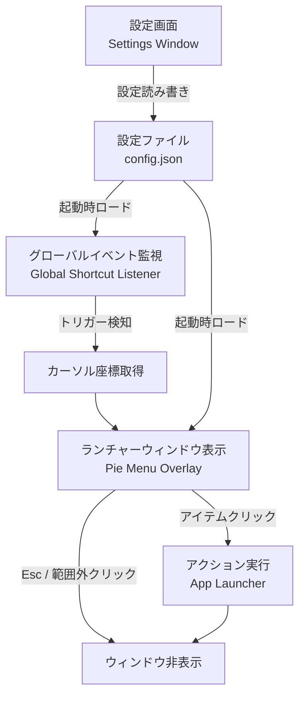
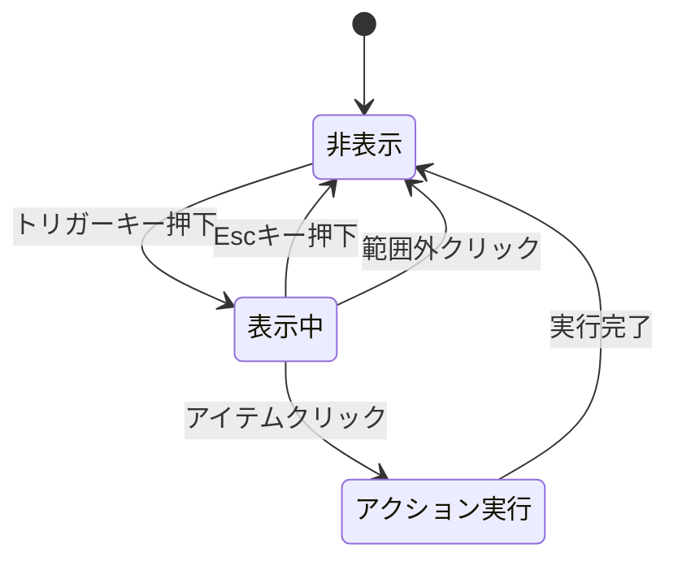
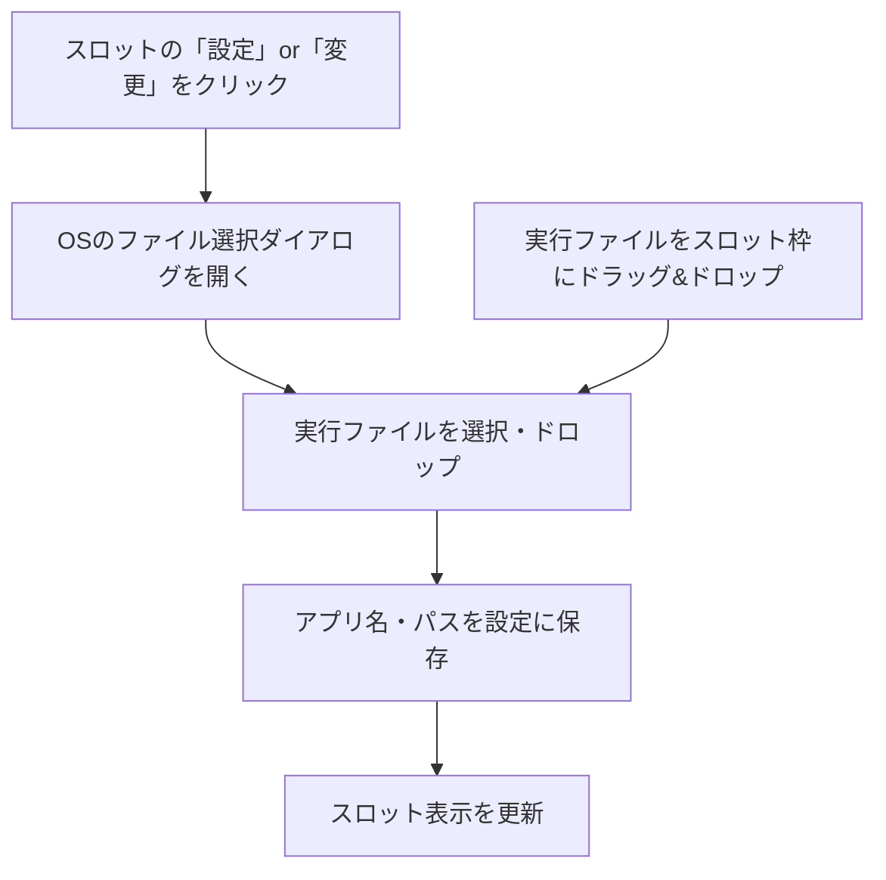
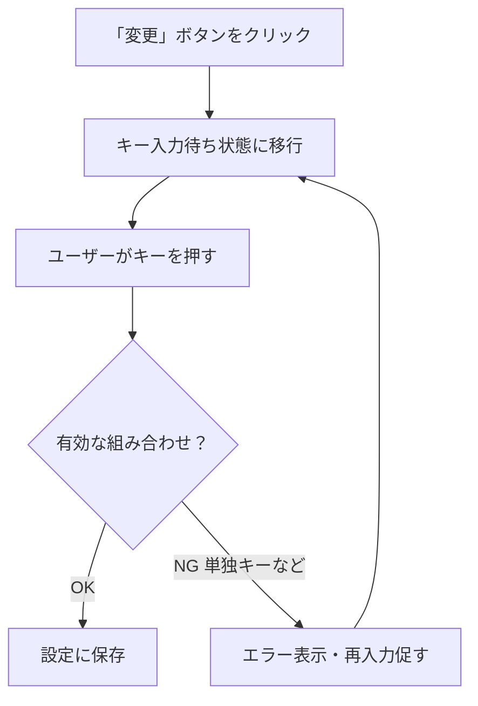
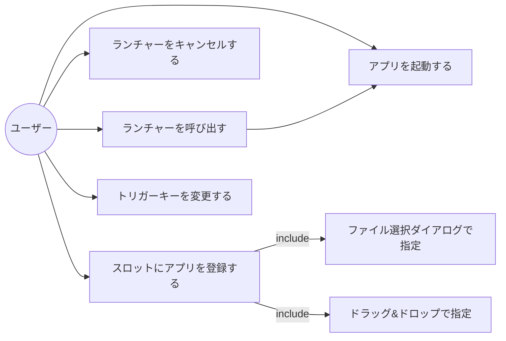
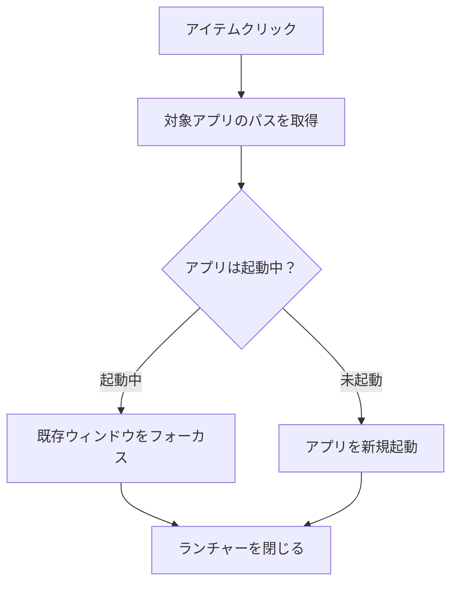

# 機能設計書

## システム構成図



---

## コンポーネント設計

### コンポーネント一覧

| コンポーネント | 役割 |
|---|---|
| **Global Shortcut Listener** | OS全体のキーボードイベントを監視し、トリガーキーの組み合わせを検知する |
| **Cursor Position Provider** | トリガー検知時点のマウスカーソル座標を取得する |
| **Pie Menu Overlay** | カーソル位置を中心に放射状メニューを表示する透明オーバーレイウィンドウ。中心に設定ボタンを配置する |
| **App Launcher** | 指定されたアプリケーションを起動、または既存ウィンドウをフォーカスする |
| **Settings Window** | スロット割り当てとトリガーキーを設定するウィンドウ。パイメニュー中心の設定ボタンから開く |
| **Config Store** | 設定の永続化・読み込みを管理する |
| **Tray Icon** | Windows ではシステムトレイ、macOS ではメニューバーにアイコンを常駐させ、アプリをバックグラウンドで維持する |

### コンポーネント間の責務境界

```
┌─────────────────────────────────────────────┐
│                  バックエンド（Rust）          │
│                                             │
│  Global Shortcut Listener                   │
│  Cursor Position Provider                   │
│  App Launcher                               │
│  Config Store                               │
│  Tray Icon（Windows: システムトレイ           │
│             macOS:   メニューバー常駐）        │
└──────────────────┬──────────────────────────┘
                   │ Tauri IPC（コマンド / イベント）
┌──────────────────▼──────────────────────────┐
│               フロントエンド（Web）            │
│                                             │
│  Pie Menu Overlay（HTML/CSS/JS）             │
│  Settings Window（HTML/CSS/JS）              │
└─────────────────────────────────────────────┘
```

---

## データモデル定義

### 設定ファイル（config.json）

```json
{
  "triggerKey": "Alt+Space",
  "slots": [
    {
      "id": 0,
      "actionType": "app",
      "appPath": "/Applications/Visual Studio Code.app",
      "appName": "Visual Studio Code",
      "iconPath": null
    },
    {
      "id": 1,
      "actionType": "app",
      "appPath": null,
      "appName": null,
      "iconPath": null
    }
  ]
}
```

### データ型定義

#### Config

| フィールド | 型 | 説明 |
|---|---|---|
| `triggerKey` | `string` | トリガーキーの組み合わせ（例："Alt+Space"） |
| `slots` | `Slot[6]` | 6スロット分の設定。インデックス 0 が 12 時方向 |

#### Slot

| フィールド | 型 | 説明 |
|---|---|---|
| `id` | `number` | スロット番号（0〜5） |
| `actionType` | `string` | アクション種別。初期実装は `"app"` 固定 |
| `appPath` | `string \| null` | 実行ファイルの絶対パス。null は未割り当て |
| `appName` | `string \| null` | 表示名。null は未割り当て |
| `iconPath` | `string \| null` | アイコン画像のキャッシュパス（将来拡張用） |

---

## 画面設計

### 1. パイメニュー（Pie Menu Overlay）

#### レイアウト

```
             [スロット 0]
          12時方向 (0°)

  [スロット 5]   [⚙️]   [スロット 1]
  300°          中心        60°

  [スロット 4]         [スロット 2]
  240°                   120°

            [スロット 3]
          180° (6時方向)
```

#### 仕様

| 項目 | 内容 |
|---|---|
| 中心 | マウスカーソルの座標 |
| 中心ボタン | 設定アイコン（歯車）。クリックで設定画面を開く |
| スロット数 | 6（固定） |
| 配置 | 12時方向（上）から時計回りに 60° 間隔 |
| 半径 | 中心から各アイテム中心まで 80px 程度 |
| 各アイテム | アプリアイコン + アプリ名ラベル |
| 未割り当て | グレーアウト表示・クリック無効 |
| 背景 | 半透明の円形背景（視認性確保） |
| 画面端対応 | カーソルが画面端に近い場合は表示位置を自動調整 |

#### 状態遷移



### 2. 設定画面（Settings Window）

#### レイアウト構成

```
┌─────────────────────────────────────┐
│  Mouse Launcher - 設定               │
├─────────────────────────────────────┤
│                                     │
│  トリガーキー                         │
│  [ Alt + Space          ] [変更]     │
│                                     │
├─────────────────────────────────────┤
│                                     │
│  ショートカット設定                    │
│                                     │
│  スロット 0 (12時)                    │
│  [ Visual Studio Code  ] [変更][削除] │
│                                     │
│  スロット 1 (2時)                     │
│  [ 未設定               ] [設定]      │
│                                     │
│  スロット 2 (4時)                     │
│  [ Chrome              ] [変更][削除] │
│                                     │
│  ... (スロット 3〜5)                  │
│                                     │
└─────────────────────────────────────┘
```

#### スロット設定の操作フロー

ファイル選択ダイアログとドラッグ&ドロップは独立した操作として並存する。



#### トリガーキー変更の操作フロー



---

## ユースケース図



---

## アクション実行の詳細フロー



---

## 将来の拡張ポイント

アクション種別を `Slot` のデータモデルに `actionType` フィールドとして追加することで、以下の拡張が可能な設計とする。

| actionType | 内容 |
|---|---|
| `app`（初期実装） | アプリケーションを起動・フォーカス |
| `url`（将来） | ブラウザでURLを開く |
| `command`（将来） | シェルコマンドを実行 |
| `snippet`（将来） | テキストをクリップボードにコピー |

スロット数についても、将来的に設定から変更できる余地を残す。
